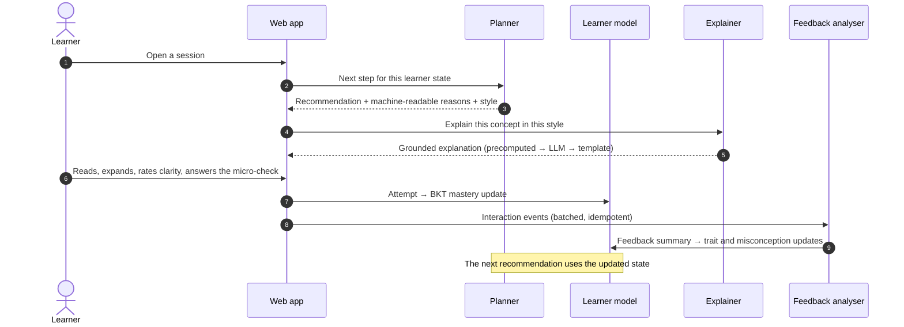
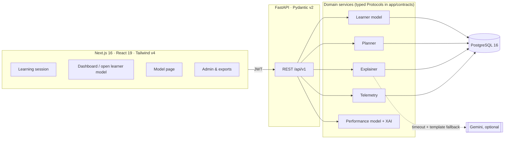

<div align="center">

# Concept

### Psychometric Concept-Graph Explanation-Feedback Engine

An adaptive tutor for data structures and algorithms. It models **what you know** and **how
you learn**, shapes every explanation to fit, treats your **interaction with each explanation
as evidence**, and shows you **why** it made each decision.

[](https://github.com/ronitmexson2924/xai-project/actions/workflows/ci.yml)


[Quick start](#quick-start) · [How it works](#how-it-works) · [Explainability](#explainability) ·
[Architecture](#architecture) · [Testing](#testing-and-quality) · [Research](#research-and-evaluation) ·
[Docs](#documentation)

</div>

---

## Overview

Most adaptive tutors adapt **what** you study next. Concept also adapts **how it explains**, and
it closes the loop. Two things feed back into one learner model:

- how you read an explanation (time spent on it, expanding it, rating its clarity);
- whether you then answer the follow-up micro-check correctly.

That model then drives the next decision.

The project is built to test one claim:

> Treating explanation interaction as a feedback signal, with explanation style chosen by a
> trait model and varied deliberately, gives (a) better prediction of the learner's next answer
> and (b) better follow-up correctness than generic explanations.

Everything in the repository exists to build or measure that claim. The pre-registered study
design and its analysis code ship with it.

### Highlights

- **A unified learner state** with three parts:
  - a mastery graph of **63 concepts** with prerequisite edges, tracked by Bayesian Knowledge
    Tracing with priors informed by prerequisites;
  - **five psychometric traits**, each held as a mean and an uncertainty;
  - a short-term **affective state**.
- **Grounded, trait-conditioned explanations.**
  - The explainer may only state facts from a curated, reviewed concept card.
  - The style is chosen per learner by a Bayesian bandit with Thompson sampling: example-first
    or rule-first, length, depth and tone.
- **Explainable by design (E1–E5).** Every recommendation carries:
  - the rule that fired, with its numbers;
  - a counterfactual verified by re-running the planner;
  - why the explanation was written the way it was;
  - what the system believes about you and why;
  - what your last action changed.
- **A trained neural network, explained four ways.** A performance model predicts each answer.
  Each prediction is explained with **SHAP, LIME, LRP and DiCE**, and the app shows how far the
  four methods agree. All of it runs in-process; no external AI service is involved.
- **Research-grade evaluation built in.**
  - three randomised experiment arms;
  - micro-randomisation inside the closed loop;
  - a learner simulator;
  - pre-registered hypotheses H1–H5;
  - pseudonymised exports.
- **Production hygiene.**
  - 242 backend tests, including an adversarial security suite;
  - Playwright end-to-end tests against the real stack;
  - load tested at 100 concurrent learners;
  - WCAG 2 AA audited UI in light and dark themes.

---

## Quick start

**Requires:** Docker (Docker Desktop on macOS and Windows).

```bash
git clone https://github.com/ronitmexson2924/xai-project.git
cd xai-project
docker compose up --build
```

Open **http://localhost:3000**. The first build takes a few minutes; later starts take seconds.

Compose runs PostgreSQL, the API (http://localhost:8000, interactive docs at
[`/docs`](http://localhost:8000/docs)) and the production frontend. On each start it migrates
the database and loads `content/`. The first start also creates these accounts:

| Account | Password | What you see |
|---|---|---|
| *Sign up* | your choice | The full first-run flow: consent → questionnaire → dashboard |
| `asha@demo.example.com` | `Demo-pass-1` | A new learner |
| `ben@demo.example.com` | `Demo-pass-1` | A misconception being remediated |
| `chen@demo.example.com` | `Demo-pass-1` | An advanced learner whose explanations are already tuned |
| `admin@example.com` | `Admin-pass-1` | The study admin dashboard and exports |

**Useful variants:**

```bash
NEXT_PUBLIC_ENGAGEMENT_UI=true docker compose up --build   # warmer learner-facing extras (see below)
docker compose down                                        # stop; data is kept
docker compose down -v                                     # stop and wipe the database
```

Explanations come from reviewed templates by default. To rephrase them with an LLM, set
`GEMINI_API_KEY` and the `GEMINI_MODEL_*` names in `.env`. No model name is hard-coded.

> [!NOTE]
> The Compose stack is for local use and demos only. It uses fixed development secrets and
> serves unreviewed (draft) items. See [Deployment](#deployment) for production.

---

## How it works

### The closed loop



### The four modules

| Module | Responsibility | Package |
|---|---|---|
| **A. Unified learner state** | BKT mastery per concept, five Gaussian traits, affect, misconception flags | `backend/app/learner_model`, `graph`, `psychometrics` |
| **B. Concept explanation generator** | Trait-conditioned explanations grounded in concept cards. Precomputed variants, an LLM fallback with a timeout, and a template floor that always answers. | `backend/app/explainer` |
| **C. Explanation-feedback analyser** | Turns dwell time, expand/replay, clarity ratings and micro-check results into an `ExplanationFeedbackSummary` | `backend/app/telemetry` → `learner_model` |
| **D. Adaptive path re-planner** | A transparent rule policy: diagnose, remediate, practise, review, advance. Each decision is recorded with its evidence and runner-up. | `backend/app/planner` |

### Causal assignment: which signal updates what

Each signal updates only the part of the state it can actually identify:

| Signal | Updates | Method |
|---|---|---|
| Follow-up correctness | Concept mastery | Bayesian Knowledge Tracing |
| Contrast between explanation styles | The three style-identifiable traits | Bayesian linear bandit |
| Questionnaire | Persistence, self-efficacy | Starting estimates. Behavioural updates are off by default: the R6 simulation showed uncalibrated proxies make these estimates worse. |
| Low clarity **and** a wrong follow-up | Misconception suspicion | +0.25 per event, halved after each correct follow-up; remediation at ≥ 0.5 |

Style selection in the closed-loop arm uses Thompson sampling with a minimum exploration rate,
so the loop cannot lock itself into one style. Full maths: [`docs/MODEL_SPEC.md`](docs/MODEL_SPEC.md).

---

## Explainability

### Decision explanations (E1–E5)

| | Question the learner can ask | Source of the answer |
|---|---|---|
| **E1** | *Why this question now?* | The planner rule that fired, with the actual values, thresholds and the alternative it passed over |
| **E2** | *What would change it?* | A counterfactual from running BKT forward, verified by re-running the planner |
| **E3** | *Why is this explanation written this way?* | The style choice, its source, and the bandit's confidence |
| **E4** | *Why do you think that about me?* | The logged state updates that moved each belief most, plus its uncertainty |
| **E5** | *What did my feedback change?* | The exact `StateDelta` produced by the learner's last action |

Every rationale is stored verbatim at decision time and shown as stored. An LLM never
paraphrases a reason, so the numbers and concept names stay faithful.

### The performance model and post-hoc XAI

A multilayer perceptron (`13 → 8 → 1`, chosen on validation data from 12 candidates) predicts
*P(correct)* for the next question. Its 13 inputs are replayed from the event log exactly as the
system knew them at the time. It **predicts but does not decide**: the planner never uses it, so
the study design stays pre-registered.

Each prediction is explained four ways:

| Method | What it shows | Implementation |
|---|---|---|
| **SHAP** (Lundberg & Lee, 2017) | Additive contribution of each factor relative to the average prediction | `shap`, permutation algorithm |
| **LIME** (Ribeiro et al., 2016) | A local linear surrogate, with its R² shown so a poor fit is visible | `lime` |
| **LRP** (Bach et al., 2015) | Relevance propagated back through the trained weights (epsilon rule) | Implemented in NumPy |
| **DiCE** (Mothilal et al., 2020) | Small, realistic changes that would flip the prediction | Implemented in NumPy |

The DiCE implementation has constraints:
- only actionable features move;
- practice can't be undone;
- a misconception can be cleared but never suggested.

Held-out results (learners the model never saw, from the simulator):

| Model | AUC | Log loss | Brier | ECE |
|---|---|---|---|---|
| Neural network (this model) | 0.726 | 0.514 | 0.170 | **0.007** |
| Logistic regression | 0.731 | 0.512 | 0.169 | 0.014 |
| BKT (the learner model) | 0.729 | 0.547 | 0.185 | 0.111 |

Explanation quality:
- mean method agreement (Spearman ρ): SHAP–LIME 0.76, LIME–LRP 0.82;
- LIME median R² 0.86;
- DiCE counterfactuals are found and valid for 100% of answers;
- deletion test: removing SHAP's top 3 factors moves the prediction 0.145, against 0.042 for 3
  random factors.

Full report: [`research/reports/performance_model.md`](research/reports/performance_model.md).
Retrain with `python -m app.ml.train` (simulated learners) or `--source db` (pilot data).

---

## Architecture



### Tech stack

| Layer | Choices |
|---|---|
| Backend | Python 3.12, FastAPI, SQLAlchemy 2.0, Alembic, Pydantic v2, NumPy, scikit-learn, `shap`, `lime` |
| Data | PostgreSQL 16; the event log is append-only, and every state change is an auditable `state_updates` row |
| Frontend | Next.js 16 (App Router), React 19, TypeScript (strict), Tailwind CSS v4, Motion, a typed client generated from OpenAPI |
| Quality | ruff, pytest, ESLint, Playwright, axe-core, `node --test` |
| Delivery | Docker Compose (local), Render blueprint (API + Postgres), Vercel (frontend), GitHub Actions CI |

### Repository layout

```text
backend/
  app/
    api/            REST routes, auth dependencies, rate limiting, error envelope
    contracts/      Typed interfaces between modules (changed only by a dedicated contract PR)
    learner_model/  BKT, traits, affect, belief attribution (E4/E5)
    planner/        Rule policy, rationale and verified counterfactuals (E1–E3), style bandit
    explainer/      Grounded explanation pipeline and offline precompute
    telemetry/      Explanation events → feedback summaries
    ml/             Feature replay, MLP, SHAP/LIME/LRP/DiCE, training pipeline
    graph/ psychometrics/ items/ auth/ db/
  alembic/          Database migrations
  tests/            Unit, API, security and integration tests
content/            63 concepts, 119 misconceptions, a 20-item questionnaire, a 282-item bank
frontend/
  src/app/          Routes: landing, auth, onboarding, dashboard, session, tests, model, admin
  src/components/   UI kit, XAI panels, session components
  tests/            Playwright end-to-end and abuse tests
research/           Learner simulator, analysis pipeline, backtests, load test, reports
docs/               Brief, architecture, data model, API contract, model spec, evaluation plan
```

---

## The web app

| Route | Purpose |
|---|---|
| `/` → `/signup` · `/login` | Landing page and authentication |
| `/onboarding` | Study consent, then the 20-statement trait questionnaire |
| `/dashboard` | Next step, the concept map with "why we think this" for every estimate, how explanations adapt |
| `/session` | The learning loop: explanation → micro-check → result → "Why this?" and the model's prediction |
| `/tests` | The pre-test and post-test (parallel forms, never scored to the learner) |
| `/model` | How the AI model works: metrics against BKT, global importance, explanation-quality checks |
| `/account` | Data and privacy, withdrawal with deletion |
| `/admin` | Study metrics and pseudonymised CSV exports (admins only) |

**Design system.**
- Semantic colour tokens for light and dark themes. The theme follows the system and can be
  overridden from the account menu.
- Colour roles are strict: indigo for the app, apricot for moments about the learner, green for
  correct, blue/orange for chart direction, red for real errors only.
- Every text token meets WCAG AA. Motion respects `prefers-reduced-motion`.
- The whole learning flow works from the keyboard: `A`–`D` to choose, `Enter` to submit and to
  continue.

**`NEXT_PUBLIC_ENGAGEMENT_UI`** is a build-time flag, off by default. It adds:
- a greeting by name;
- result moments, including *"You beat the prediction"*;
- an animated mastery meter;
- a session progress strip and recap;
- the model panel written in the second person.

It changes presentation only. With it off, every study arm sees the same plain interface.

---

## Development

```bash
cp .env.example .env
docker compose up -d db                                   # PostgreSQL on :5432

# Backend
cd backend
python -m venv .venv && . .venv/bin/activate
pip install -e ".[dev]"
alembic upgrade head
python -m app.graph.seed ../content                       # concepts, misconceptions, items, questionnaire
python -m app.graph.demo_seed --password 'Demo-pass-1'    # optional demo learners
python -m app.auth.onboard admin --email you@example.com  # an admin account (prompts for a password)
INCLUDE_DRAFT_ITEMS=true uvicorn app.main:app --reload    # http://localhost:8000/docs

# Frontend (second terminal)
cd frontend && npm ci && npm run dev                      # http://localhost:3000
npm run gen:api                                           # regenerate the typed API client
```

### Configuration

All configuration comes from environment variables (see [`.env.example`](.env.example)). None is
hard-coded.

| Variable | Default | Purpose |
|---|---|---|
| `ENVIRONMENT` | `development` | `production` refuses to start with a weak `JWT_SECRET`, `CORS_ORIGINS=*` or draft items |
| `DATABASE_URL` | local Postgres | SQLAlchemy URL (`postgresql+psycopg://…`) |
| `JWT_SECRET`, `JWT_EXPIRE_HOURS` | — / `24` | Token signing; 32+ random characters in production |
| `CORS_ORIGINS` | `http://localhost:3000` | The frontend origin(s), comma separated |
| `ANALYSIS_SALT` | — | HMAC salt for pseudonymous research exports; fixed for a study |
| `INCLUDE_DRAFT_ITEMS` | `false` | Serve unreviewed items (demos only) |
| `RATE_LIMIT_*`, `LOGIN_MAX_FAILURES`, `LOGIN_LOCKOUT_SECONDS` | `120/min`, `5`, `900 s` | Abuse protection |
| `GEMINI_API_KEY`, `GEMINI_MODEL_EXPLAIN`, `GEMINI_MODEL_OFFLINE`, `LLM_TIMEOUT_SECONDS` | — | Optional LLM rephrasing |
| `NEXT_PUBLIC_API_URL` | `http://localhost:8000` | API base URL compiled into the frontend |
| `NEXT_PUBLIC_ENGAGEMENT_UI`, `NEXT_PUBLIC_RECAP_EVERY` | `false`, `5` | Engagement extras and the recap interval |

---

## Testing and quality

```bash
cd backend  && ruff check . && ruff format --check . && pytest -q
cd frontend && npm run lint && npm run test:unit && npm run build
cd frontend && PYTHON=../backend/.venv/bin/python npx playwright test   # starts a fresh pcg_e2e database
```

| Suite | Scope |
|---|---|
| **Backend: 242 tests** | Learner model maths, planner policy and rationale, explainer grounding, telemetry idempotency, API contracts, the ML explainers' formal properties (SHAP additivity, LRP conservation, LIME recovery, DiCE validity and feasibility) |
| **Security** (`test_security.py`, `abuse.spec.ts`) | Forged and revoked tokens, access to other learners' data, replayed answers, injection, oversized payloads, login lockout |
| **End to end: 20 Playwright tests** | The whole study journey in a real browser against Postgres, the API and the production build, plus keyboard-only, dark-mode and phone-width accessibility checks |
| **Frontend unit: 15 tests** | Learner-facing copy generators and the code highlighter |
| **Load** (`research/load_test.py`) | 100 concurrent learners: `session/next` p95 35 ms (budget 300 ms), `attempts` p95 54 ms (budget 200 ms) |

CI ([`.github/workflows/ci.yml`](.github/workflows/ci.yml)) runs four jobs on every PR:
- **backend:** lint and tests;
- **frontend:** lint, unit tests and build;
- **e2e:** Playwright against Postgres, the API and the production build;
- **compose:** builds the full Docker stack and checks that it comes up healthy.

---

## Research and evaluation

Learners are randomised at signup, with balanced allocation, into three arms:

| Arm | Explanation style |
|---|---|
| `generic` | The same style for everyone |
| `static_personalized` | Chosen from questionnaire traits, never updated |
| `closed_loop` | The full system: chosen by the bandit and updated from feedback |

| | Hypothesis | Evidence |
|---|---|---|
| **H1** | Explanation-interaction features improve prediction of the next answer | AUC and log loss, BKT vs BKT + feedback features, cross-validated by learner |
| **H2** | Trait-conditioned style raises micro-check correctness compared with the generic style | Mixed-effects logistic regression with micro-randomisation |
| **H3** | The closed loop recovers true preferences without locking in | Simulator: trait recovery error, exploration share, regret |
| **H4** | The full system improves learning gain | Normalised pre/post gain, reported as an effect size with a 95% CI |
| **H5** *(exploratory)* | Drift and resonance alerts come before failure | Lead time, precision and recall |

The pre-registration and analysis code are in [`research/`](research/). The rules are in
[`docs/EVALUATION_PLAN.md`](docs/EVALUATION_PLAN.md). Results on simulated learners are in
[`research/reports/`](research/reports/).

### Privacy and ethics

- Informed consent before any data is collected. Withdrawal deletes the account and its data
  (`python -m app.auth.purge`).
- Research exports use HMAC pseudonyms. There is no third-party analytics, and the Content
  Security Policy forbids external scripts.
- The trait model deliberately has **no "learning styles"** (visual, auditory and so on), a
  construct the evidence does not support. See
  [`docs/CRITICAL_REVIEW.md`](docs/CRITICAL_REVIEW.md) §2.3.
- Attributions describe the model, not causes in the learner. The UI says so.

---

## Deployment

| Component | Target | Notes |
|---|---|---|
| API + PostgreSQL | Render ([`render.yaml`](render.yaml)) | Runs with `ENVIRONMENT=production`; migrations and content seeding run on start |
| Frontend | Vercel ([`frontend/vercel.json`](frontend/vercel.json)) | Set `NEXT_PUBLIC_API_URL` to the API URL, and put the frontend URL in the API's `CORS_ORIGINS` |

Operations:

```bash
python -m app.auth.onboard cohort --count 45 --output-csv pilot.roster.csv   # pilot accounts (*.roster.csv is git-ignored)
python -m app.auth.purge                                                      # scheduled: delete withdrawn accounts
```

Only `approved` items are served in production.

---

## Project status

| Area | Status |
|---|---|
| Learner model, planner, explainer, telemetry, API, web app | Complete and tested |
| Decision explanations E1–E5 and the performance model with SHAP/LIME/LRP/DiCE | Complete and tested |
| Item bank (282 items) | Drafted; awaiting content review before the pilot ([#3](https://github.com/ronitmexson2924/xai-project/issues/3)) |
| Performance model | Trained on simulated learners; retrain on pilot data with `--source db` |
| Pilot study | Protocol and analysis pre-registered; not yet run |

**Known limitations:**
- The demo seed dates its learners' attempts at a fixed future date. So for the demo accounts
  only, the model panel's mastery input can differ from "What this changed". Real learners are
  unaffected.
- On simulated data the neural network is about as accurate as BKT. Its value here is the
  explanation layer, not a gain in accuracy.

---

## Documentation

| Document | Contents |
|---|---|
| [`docs/PROJECT_BRIEF.md`](docs/PROJECT_BRIEF.md) | Scope, the central claim, design decisions D1–D11, non-goals |
| [`docs/ARCHITECTURE.md`](docs/ARCHITECTURE.md) | Components, the closed loop, ownership boundaries |
| [`docs/MODEL_SPEC.md`](docs/MODEL_SPEC.md) | BKT, the trait bandit, planner rules, resonance and drift maths |
| [`docs/XAI_DESIGN.md`](docs/XAI_DESIGN.md) | The explainability design (E1–E5) and faithfulness rules |
| [`docs/DATA_MODEL.md`](docs/DATA_MODEL.md) · [`docs/API_CONTRACT.md`](docs/API_CONTRACT.md) | Tables and endpoints |
| [`docs/EVALUATION_PLAN.md`](docs/EVALUATION_PLAN.md) | Hypotheses, pilot protocol, reporting rules |
| [`docs/CRITICAL_REVIEW.md`](docs/CRITICAL_REVIEW.md) | An honest assessment of the design's weak points |
| [`docs/DEMO_WALKTHROUGH.md`](docs/DEMO_WALKTHROUGH.md) | A guided tour of the demo accounts |
| [`docs/TEAM_PLAN.md`](docs/TEAM_PLAN.md) · [`docs/GIT_WORKFLOW.md`](docs/GIT_WORKFLOW.md) | Responsibilities, branching and releases |

---

## Contributing

| Branch | Purpose | Updated by |
|---|---|---|
| `main` | Stable, tested releases | PR from `dev` only, with both maintainers' agreement |
| `dev` | Integration: everything is combined and tested here | PRs from working branches |
| `ronit*` / `mit*` | Working branches | Their owner |

- Commits follow `<TaskID>: <imperative summary>`.
- PRs target `dev` and use the [PR template](.github/pull_request_template.md).
- Interfaces in `backend/app/contracts/` change only through a dedicated, jointly approved
  `contract` PR.
- Coding agents start with [`AGENTS.md`](AGENTS.md).

**Maintainers:**
- **Ronit:** learner model, planner, content, research.
- **Mit:** explainer, telemetry, API, frontend, deployment.
