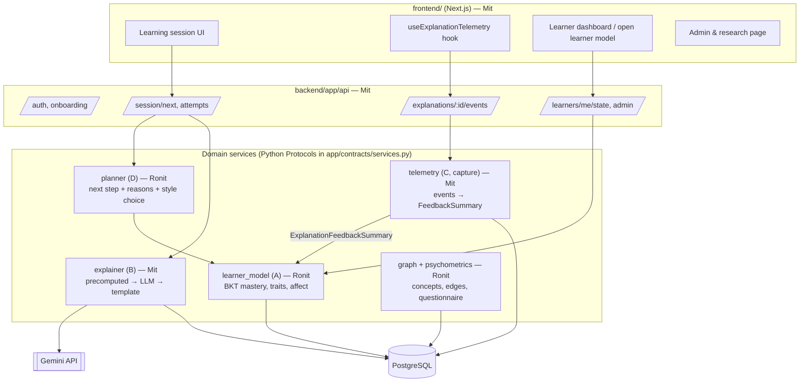
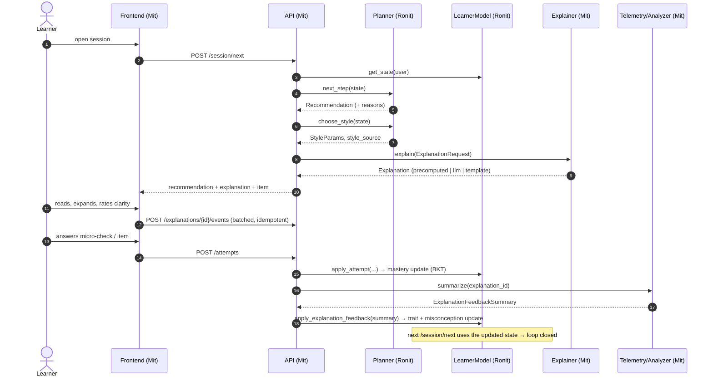

# Architecture

## Component view

## The closed loop, step by step

## Ownership boundaries

Each person owns the directories listed for them, and only the owner edits
them. To change something you don't own, open an issue or ask the owner. The
owner reviews every PR to `dev` that touches their area.

| Path | Owner |
|---|---|
| `backend/app/contracts/` | **Shared.** Changes only through a PR labelled `contract`, approved by both. |
| `backend/app/db/`, `backend/alembic/` | Ronit |
| `backend/app/graph/`, `backend/app/psychometrics/`, `backend/app/learner_model/`, `backend/app/planner/` | Ronit |
| `content/` (concept graph, concept cards, misconceptions, questionnaire) | Ronit |
| `content/items/` (item bank) | Mit (both review) |
| `research/` | Ronit |
| `backend/app/api/`, `backend/app/explainer/`, `backend/app/telemetry/`, `backend/app/auth/` | Mit |
| `frontend/` | Mit |
| `.github/`, `docker-compose.yml`, deploy config | Mit. Ronit adds the Postgres service to CI in task R0. |
| `docs/`, `AGENTS.md`, `tasks/` | Shared. Update your own task file freely. |

## How services connect

- `app/contracts/services.py` defines one Protocol per service.
  `app/contracts/fakes.py` has in-memory fakes, so each person can build
  against the other's interface before the real code exists.
- The API layer gets services through FastAPI dependencies in
  `app/api/deps.py`, which Mit creates in M1. Swapping a fake for the real
  implementation is a one-line change there.
- Database access goes through repository functions in `app/db/`, owned by
  Ronit. Mit's packages (explainer, telemetry) define their own tables in
  `DATA_MODEL.md`. Ronit writes the initial migration for **all** tables in
  R0. After that, each owner adds migrations for their own tables: rebase onto
  `dev` first so Alembic has a single head.

## Latency budget (p95)

| Call | Budget | How |
|---|---|---|
| `POST /session/next` | 300 ms | State in a single query; precomputed explanation |
| `POST /attempts` | 200 ms | BKT is O(1); feedback update runs as a background task |
| `POST /explanations/{id}/events` | 100 ms | Append-only insert with an idempotency key |
| Live LLM fallback | 4 s timeout | After the timeout, the template fallback is used |
