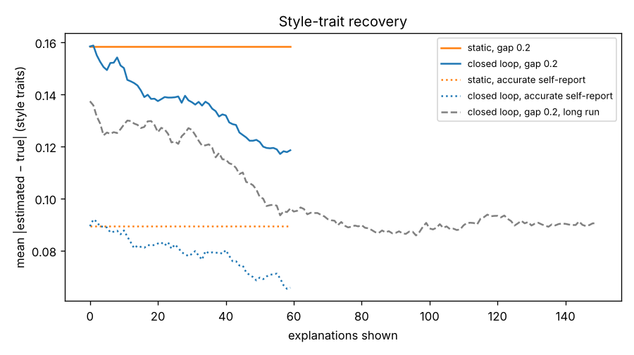
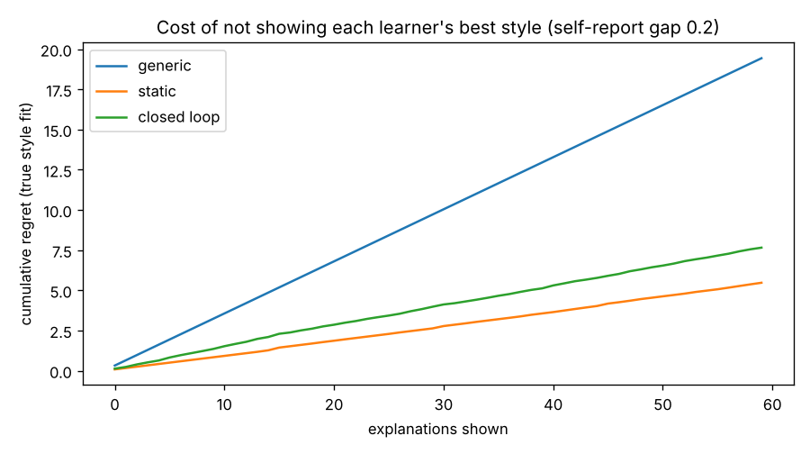

# Simulation study (R6, hypothesis H3)

> Generated by `research/simulate.py` in 33.6 min. **Do not edit by hand**: rerun the script. The interpretation and the design decisions taken from it are in `tasks/ronit.md` (R6) and `docs/MODEL_SPEC.md`.

## Setup

- 40 synthetic learners per arm, with **the same learners and questionnaire answers in every arm** (paired), 60 explanations each. Real `LearnerModel` + `Planner` on Postgres; the fake explainer stands in for Module B.
- True traits ~ Beta(2, 2). Learners answer the questionnaire from their *self-view*: true trait + N(0, gap), plus item noise. Two worlds:
  - **gap 0.2** (main): self-report only partly matches what actually helps. This is the case the closed loop exists for.
  - **accurate self-report** (gap 0): the questionnaire already tells the truth.
- The response model uses the bandit's own functional form (a well-specified world). A better-fitting style makes an explanation more likely to teach the concept, raises the clarity rating (asked on 1 in 3) and lowers quick dismissals. Micro-checks are answered 80% of the time. Learners quit sessions after wrong answers (more often with low persistence) and sometimes rate their confidence.

## Key numbers

- With a self-report gap, the closed loop cuts style-trait error from 0.158 to 0.118 (**25% lower**) in 60 explanations. Static stays at 0.158.
- With accurate self-report it barely moves: 0.089 → 0.066.
- Over 60 explanations, regret per explanation is 0.128 (closed loop) vs 0.091 (static) and 0.324 (generic). In the long run (150 explanations), the closed loop's regret per explanation is 0.128 in the first half and 0.101 in the second.
- Learning gain, closed loop − static (paired): -0.002 (95% CI -0.014 to +0.011); closed loop − generic: +0.037 (95% CI +0.019 to +0.054).
- Behavioural-trait EWMA (rate 0.05) moves persistence/self-efficacy error from 0.160 (off) to 0.221 (on).
- Lowest-regret setting in the sweep: ε = 0.0, questionnaire variance = 0.04.

## 1. Three arms, self-report gap 0.2 (main)

| metric | generic | static | closed loop |
|---|---|---|---|
| style-trait error, start (questionnaire) | 0.158 | 0.158 | 0.158 |
| style-trait error, end | 0.158 | 0.158 | 0.118 |
| persistence + self-efficacy error, end | 0.160 | 0.160 | 0.160 |
| regret per explanation | 0.324 | 0.091 | 0.128 |
| micro-check accuracy | 0.642 | 0.701 | 0.707 |
| learning gain (share of concepts known) | 0.188 | 0.226 | 0.225 |
| distinct styles shown per learner | 1.0 | 1.7 | 8.7 |

## 2. Three arms, accurate self-report

| metric | generic | static | closed loop |
|---|---|---|---|
| style-trait error, start (questionnaire) | 0.089 | 0.089 | 0.089 |
| style-trait error, end | 0.089 | 0.089 | 0.066 |
| persistence + self-efficacy error, end | 0.098 | 0.098 | 0.098 |
| regret per explanation | 0.207 | 0.046 | 0.101 |
| micro-check accuracy | 0.677 | 0.709 | 0.715 |
| learning gain (share of concepts known) | 0.200 | 0.226 | 0.217 |
| distinct styles shown per learner | 1.0 | 1.8 | 8.9 |

## 3. Trait recovery and regret over time

Long run (24 learners, gap 0.2): error 0.137 after 0, 0.126 after 30, 0.095 after 60, 0.089 after 100, 0.091 after 149.

## 4. Does the loop invent preferences?

A population with **no** true style preference (all three style traits 0.5), gap 0.2. Share of final style-trait estimates more than 0.15 from 0.5:

| arm | claimed-preference share | mean distance from 0.5 |
|---|---|---|
| static | 0.467 | 0.165 |
| closed loop | 0.217 | 0.099 |

## 5. Behavioural traits (persistence, self-efficacy)

| closed loop, gap world | error at the end |
|---|---|
| EWMA off (new default) | 0.160 |
| EWMA on, rate 0.05 (v0 default) | 0.221 |

The EWMA pulls each trait toward its raw proxy (share of 'kept going after a wrong answer', calibrated confidence). Nothing guarantees that a proxy's average equals the trait, so the estimate drifts away from the truth.

## 6. Parameter sweep (closed loop, gap world, same learners for every setting)

| ε | questionnaire variance | style-trait error | regret / expl. | non-greedy | learning gain |
|---|---|---|---|---|---|
| 0.0 | 0.04 | 0.116 ± 0.010 | 0.119 | 48.5% | 0.224 |
| 0.0 | 0.09 | 0.112 ± 0.010 | 0.132 | 55.9% | 0.228 |
| 0.05 | 0.04 | 0.109 ± 0.011 | 0.126 | 51.2% | 0.225 |
| 0.05 | 0.09 | 0.103 ± 0.011 | 0.135 | 57.0% | 0.212 |
| 0.1 | 0.04 | 0.106 ± 0.010 | 0.142 | 56.8% | 0.224 |
| 0.1 | 0.09 | 0.114 ± 0.010 | 0.156 | 60.2% | 0.217 |

ε is the forced-exploration floor; Thompson sampling explores on top of it. 'Non-greedy' is the share of styles that differ from the posterior-mean best.

## 7. Limitations

- **Well-specified world.** Simulated learners respond exactly the way the bandit assumes, so recovery here is an upper bound.
- **Assumed noise levels.** Clarity noise, dismissal rate, micro-check answer rate, questionnaire noise and the self-report gap are guesses. The pilot (R8) must measure them; the gap matters most.
- **Assumed style effect size.** `explanation_fit_gain` sets how much a well-fitting style helps learning. Learning-gain differences scale with it, so they show the mechanism, not the size of the real effect.
- **Trait scale.** Reported traits assume one trait unit moves y by κ. If real y responds more or less strongly, estimates are stretched or shrunk toward 0.5. Style *choice* is unaffected, but the pilot should estimate κ.
- The fake explainer returns the concept card. Explanation content quality is not simulated.
